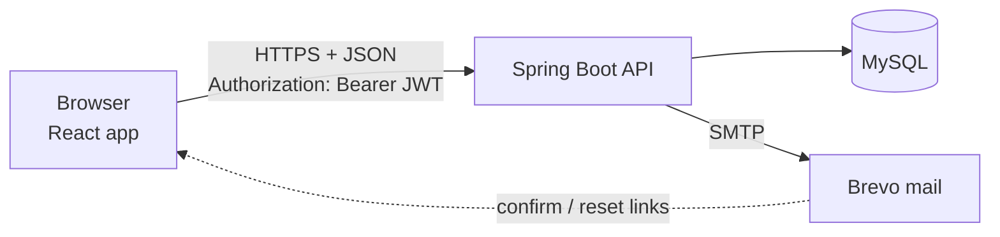
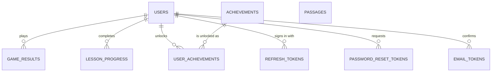
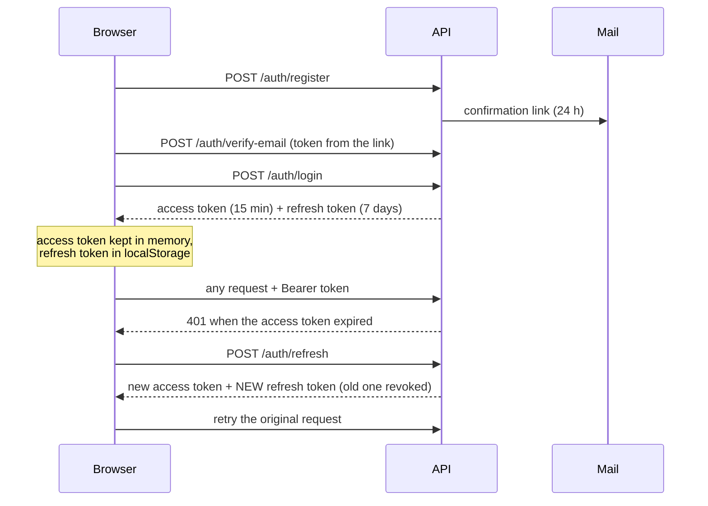

# TypeQuest

**Learn to type, properly.** TypeQuest is a full-stack typing tutor: an 8-level touch-typing course, free
practice drills, five typing games, XP and levels, achievements, a leaderboard and an admin area. It has a
"typewriter and paper" look with light, dark and system themes, and synthesized typewriter sound effects.

New visitors can try the games, Practice and the first lesson **without an account**; an account saves
progress.

| Part | Technology |
|---|---|
| Backend (`src/`) | Java 25, Spring Boot 4.1, Spring Security (JWT), Spring Data JPA / Hibernate, MySQL, Brevo SMTP |
| Frontend (`frontend/`) | React 19, React Router 7, Vite 8, plain CSS (no UI library) |
| Tests | JUnit 5, Mockito, Spring Boot Test (98 backend tests) |
| Ops | Docker, docker compose, GitHub Actions CI, Render + Vercel + Aiven (free hosting guide) |

---

## Contents

1. [Features](#1-features)
2. [How it fits together](#2-how-it-fits-together)
3. [Run it on your computer](#3-run-it-on-your-computer)
4. [Configuration reference](#4-configuration-reference)
5. [Backend, piece by piece](#5-backend-piece-by-piece)
6. [REST API reference](#6-rest-api-reference)
7. [Database](#7-database)
8. [Frontend, piece by piece](#8-frontend-piece-by-piece)
9. [Main flows, step by step](#9-main-flows-step-by-step)
10. [Security design](#10-security-design)
11. [Testing and CI](#11-testing-and-ci)
12. [Deploying](#12-deploying)
13. [Troubleshooting](#13-troubleshooting)
14. [Ideas for later](#14-ideas-for-later)

---

## 1. Features

**For visitors (no account)**
- A welcome page with a one-line typing taste and a "Try these first" grid.
- All five games, free Practice, and the first level of lessons. Results are not saved; a banner invites the
  visitor to register.

**For players**
- **Learn**: 8 levels and 26 lessons (keyboard basics, home row, upper row, bottom row, numbers and symbols,
  words and sentences, speed and accuracy, real-world typing). Each lesson has an exercise with 1–3 stars and
  an on-screen keyboard that shows the finger for each key.
- **Practice**: drills built from the keys you choose, or from the keys you personally miss most.
- **Games**: Typing Speed, Typing Racer, Word Survival, Space Mission, Ninja Word Strike.
- **Progress**: XP, levels, rank titles, history, five achievements, a top-100 leaderboard.
- **Settings**: Light / Dark / System theme, sound and volume, change password, change email (confirmed by
  email), resend confirmation, delete account.

**For admins**
- Dashboard numbers, user management (disable, ban from leaderboard, change role, unlock, reset XP),
  moderate game results, edit achievements, and edit the passages used by the typing games.

**For the person running it**
- Rate limiting, account lockout, refresh-token rotation, browser crash reports in the server log, health
  check endpoint, Docker files, nightly backup scripts, and a free deployment guide.

---

## 2. How it fits together



- The **frontend** is a single-page app. It holds the short-lived access token in memory and a refresh token in
  `localStorage`. It talks to the backend only through `fetch`.
- The **backend** is stateless: no server sessions. Every request carries a signed JWT that the API verifies.
  All durable state is in MySQL.
- **Email** is used for confirming an address, changing an address, and resetting a password. Only a hash of
  each emailed token is stored.

Repository layout:

```
typequest/
├── src/main/java/com/typequest/   Spring Boot backend (see section 5)
├── src/main/resources/            application.properties
├── src/test/java/com/typequest/   backend tests
├── frontend/                      React app (see section 8)
├── Dockerfile                     backend image (low-memory JVM settings)
├── docker-compose.yml             MySQL + API + frontend on one machine
├── render.yaml                    Render blueprint (free backend)
├── deploy/Caddyfile.example       HTTPS reverse proxy for a VPS
├── scripts/backup.sh, restore.sh  database dump and restore
├── .github/workflows/ci.yml       tests + frontend build on every push
├── .env.example                   every environment variable, with notes
├── DEPLOY.md                      deploying on a server you rent
└── DEPLOY-FREE.md                 deploying on free tiers (Vercel + Render + Aiven)
```

---

## 3. Run it on your computer

You need Java 25, Node 20+ and MySQL 8.

1. **Database**: create an empty database, for example `typequest_db`.
2. **Backend**: set the environment variables from `.env.example` (at minimum `DB_USERNAME`, `DB_PASSWORD`,
   `TYPEQUEST_JWT_SECRET`, `MAIL_*`), then:
   ```bash
   ./mvnw spring-boot:run        # API on http://localhost:8080
   ```
   Generate the JWT secret with `openssl rand -base64 48`.
   Tables are created automatically (`JPA_DDL_AUTO=update`).
3. **Frontend**:
   ```bash
   cd frontend
   cp .env.example .env          # VITE_API_BASE_URL=http://localhost:8080
   npm install
   npm run dev                   # http://localhost:5173
   ```
   The `.env` file must be in `frontend/`, not in `frontend/src/`.
4. **Admin account (optional)**: set `TYPEQUEST_ADMIN_EMAIL` and `TYPEQUEST_ADMIN_PASSWORD` (12+ characters)
   before the first start; the app creates the user `admin`.

Run the tests with `./mvnw test` and build the frontend with `npm run build` (inside `frontend/`).

---

## 4. Configuration reference

Everything is an environment variable; `application.properties` maps them to Spring settings.

| Variable | Default | Meaning |
|---|---|---|
| `DB_URL` | `jdbc:mysql://localhost:3306/typequest_db` | JDBC URL. Must start with `jdbc:mysql://`. |
| `DB_USERNAME`, `DB_PASSWORD` | – | Database login. |
| `DB_POOL_SIZE` | `5` | Maximum database connections. |
| `JPA_DDL_AUTO` | `update` | `update` adds missing tables/columns; `none` or `validate` for stable production. |
| `JPA_SHOW_SQL` | `false` | Log every SQL statement (debugging only). |
| `TYPEQUEST_JWT_SECRET` | – | Base64 text of at least 32 random bytes; signs access tokens (HS256). |
| `TYPEQUEST_ADMIN_EMAIL`, `TYPEQUEST_ADMIN_PASSWORD` | empty | Creates the `admin` user at startup. |
| `MAIL_HOST`, `MAIL_PORT`, `MAIL_USERNAME`, `MAIL_PASSWORD`, `MAIL_FROM` | – | SMTP server (Brevo) and sender address. |
| `TYPEQUEST_CORS_ALLOWED_ORIGINS` | `http://localhost:5173` | Comma-separated website addresses allowed to call the API. `*` patterns are allowed. |
| `PASSWORD_RESET_BASE_URL` | `…/reset-password` on localhost | Frontend page the reset email links to. |
| `EMAIL_VERIFICATION_BASE_URL` | `…/verify-email` on localhost | Frontend page the confirmation email links to. |
| `TYPEQUEST_TRUSTED_PROXY_HOPS` | `0` | Reverse proxies in front of the API (use `1` on Render). Needed for correct per-IP rate limits. |
| `PORT` | `8080` | Port to listen on (hosting platforms set it). |
| `JAVA_TOOL_OPTIONS` | low-memory flags in the Dockerfile | JVM options. |

Frontend (set at **build** time, `frontend/.env` or the Vercel dashboard):

| Variable | Meaning |
|---|---|
| `VITE_API_BASE_URL` | Address of the API, without a trailing slash. |
| `VITE_CONTACT_EMAIL` | Contact address shown on the privacy page. |

---

## 5. Backend, piece by piece

Package `com.typequest`. The structure is the usual Spring layering:
**controller** (HTTP) → **service** (rules) → **repository** (database) → **model** (tables).
DTO classes in `dto/` define the JSON in and out, with validation annotations.

### 5.1 Startup and configuration (`config/`)

| Class | What it does |
|---|---|
| `TypequestApplication` | Entry point. `@EnableScheduling` turns on the cleanup job in `RateLimitService`. |
| `SecurityConfig` | The security rules. Stateless sessions, CSRF off (tokens are not cookies). Public endpoints: register, login, forgot/reset password, refresh, verify-email, client-errors, `/actuator/health`. Everything else needs a valid JWT. Roles are read from the token's `roles` claim. Defines CORS (allowed origins from the environment, headers `Authorization`, `Content-Type`, `Accept`) and the BCrypt password encoder. |
| `JwtConfig` | Decodes `TYPEQUEST_JWT_SECRET`, refuses a key shorter than 32 bytes, and builds the JWT encoder/decoder (HS256). |
| `RateLimitInterceptor` + `WebMvcConfig` | Runs before controllers and limits calls per IP address and path (see section 10). Returns HTTP 429 with a JSON message. |
| `ClientIpResolver` | Finds the caller's real IP. With `TYPEQUEST_TRUSTED_PROXY_HOPS=n` it reads the n-th entry from the **right** of `X-Forwarded-For` (the part the proxy wrote), ignores forged values, and accepts only characters an IP can contain. |
| `AdminAccountInitializer` | At startup, if admin email and password are configured, creates the `admin` user (email already verified). It refuses to continue if the email or the username `admin` belongs to someone else. |
| `AchievementDataInitializer` | At startup, inserts the five achievement definitions if they are missing. |

### 5.2 Models = database tables (`model/`)

| Class | Table | Purpose |
|---|---|---|
| `User` | `users` | Account: username (unique ignoring case), email (unique), BCrypt `password`, `totalXp`, `level`, `role`, `disabled`, `leaderboardBanned`, `emailVerified`, `failedLoginAttempts`, `lockedUntil`, `createdAt`. |
| `Role` | – | `ROLE_USER`, `ROLE_ADMIN`. |
| `GameResult` | `game_results` | One finished game: wpm, accuracy, correct/incorrect characters, duration, score, `gameType`, `difficulty`, `playedAt`, the user. |
| `GameType` | – | `TYPING_SPEED_CHALLENGE`, `TYPING_RACE`, `WORD_SURVIVAL`, `SPACE_MISSION`, `NINJA_WORD_STRIKE` (plus an old `WORD_RAIN`). Stored as text so new games need no migration. |
| `LessonProgress` | `lesson_progress` | One row per user and lesson: `completed`, best WPM, best accuracy, timestamps. |
| `Achievement` / `UserAchievement` | `achievements`, `user_achievements` | Definitions (`code`, name, description, icon, `xpReward`) and who unlocked what, when. |
| `RefreshToken` | `refresh_tokens` | SHA-256 hash of a refresh token, expiry, `revoked`. The raw token is never stored. |
| `PasswordResetToken` | `password_reset_tokens` | Hash of a reset token, expiry, `used`. |
| `EmailToken` | `email_tokens` | Hash of a confirm/change token, `purpose` (`VERIFY` or `CHANGE`), `newEmail`, expiry, `used`. |
| `Passage` | `passages` | Texts for Typing Speed and Typing Racer: `category` (`SPEED`/`RACE`), `text`, `active`. Managed by admins. |

### 5.3 Repositories (`repository/`)

Spring Data interfaces; Spring writes the SQL from the method names. The ones with extra behaviour:
`UserRepository.findByEmailForUpdate` takes a **pessimistic write lock** so two simultaneous logins cannot both
miss the failed-attempt counter; `RefreshTokenRepository.findByTokenHashForUpdate` and
`EmailTokenRepository.findByTokenHashForUpdate` lock a token row while it is used, so a token cannot be spent
twice; `UserRepository.findTop100…BannedFalse…` powers the leaderboard.

### 5.4 Services (`service/`)

| Class | Responsibility |
|---|---|
| `AuthService` | **Register**: trims and lowercases the email, checks the password policy, checks email and username (case-insensitive) are free, stores the BCrypt hash, sends the confirmation email (a mail failure never fails sign-up). Database constraints are the last line of defence against two simultaneous sign-ups. **Login**: locks the user row; rejects while locked; on a wrong password counts a failure and locks the account for 15 minutes after 5 in a row; rejects disabled accounts; on success resets the counter and returns a 15-minute access token and a refresh token. All failures return the same message so attackers cannot learn which emails exist. |
| `JwtService` | Builds the access token: issuer `typequest`, subject = user id, claims `email` and `roles`, valid 15 minutes, signed HS256. |
| `RefreshTokenService` | Creates a random 32-byte refresh token (valid 7 days) and stores only its hash. **Rotation**: using a refresh token revokes it and issues a new one. Also: validate, revoke one, revoke all of a user's tokens, revoke all except the current device (used after a password change). |
| `PasswordPolicy` | One rule everywhere: 12–72 characters, with the limit counted in UTF-8 **bytes** because BCrypt ignores everything past 72 bytes. |
| `PasswordResetService` | Forgot password: always answers the same way whether or not the account exists; retires older unused tokens; emails a single-use link. Reset: checks the token, sets the new password, signs the user out everywhere and clears any lockout. |
| `EmailVerificationService` | Sends the confirmation link (valid 24 h). Handles "change email": the link goes to the **new** address and the account keeps the old one until the link is used. `confirm` marks the email verified (and applies the new address for a change) and spends the token. |
| `EmailService` | Builds and sends the four emails (confirm, change, reset, test) through Spring Mail. |
| `AccountService` | Signed-in self-service: change password (checks the current one, signs out other devices, invalidates reset links), delete account (password required; removes tokens, progress, achievements, games, then the user; admins cannot delete themselves this way). |
| `XpService` | XP rules (below) and level maths. |
| `AchievementService` | Defines and awards achievements (below). |
| `GameService` | Validates, scores and saves a finished game, then awards XP and achievements (see section 9.3). Also returns history. |
| `LessonProgressService` | Reads and saves lesson progress. Keeps the **best** WPM and best accuracy and never un-completes a lesson. Validates the lesson id and ranges. |
| `AdminService` | Everything the admin area needs: statistics, user search/update/unlock/XP reset, game list/delete, achievement edit, passage create/update/delete/bulk import (duplicates skipped). Prevents an admin from disabling or demoting themselves; disabling a user revokes their refresh tokens. |
| `RateLimitService` | In-memory counter per key in a 15-minute window, cleaned up every minute by `@Scheduled`. Used by the interceptor and by game submission. |
| `TokenHashing` | Random single-use tokens and SHA-256 hashing for email links. |

**XP and levels (`XpService`)**

- Every finished game earns **50 XP**, plus: accuracy ≥ 95 → +20, ≥ 90 → +10; WPM ≥ 60 → +15, ≥ 40 → +10;
  difficulty `INTERMEDIATE` → +10, `ADVANCED` → +20.
- **Level**: level *n* begins at `50 × n × (n − 1)` total XP: L2 = 100, L3 = 300, L4 = 600, L5 = 1000 …
  The frontend (`utils/progression.js`) uses the same formula.
- Game **score** = `round(wpm × accuracy / 10)`.

**Achievements (`AchievementService`)**

| Code | Condition | Bonus XP |
|---|---|---|
| `FIRST_STEPS` | first finished game | 50 |
| `SHARP_SHOOTER` | accuracy ≥ 95 | 25 |
| `SPEED_DEMON` | WPM ≥ 60 | 30 |
| `DEDICATED_PLAYER` | 10 finished games | 50 |
| `RISING_STAR` | reach level 5 | 100 |

Each is awarded once per user; bonus XP is added immediately.

### 5.5 Controllers (`controller/`)

Thin classes: read the request, find the user id from the JWT (`jwt.getSubject()`), call a service, return JSON.

`AuthController`, `PasswordResetController`, `EmailVerificationController` (public sign-in related),
`UserController` (profile), `GameController`, `LeaderboardController`, `AchievementController`,
`LessonProgressController`, `AccountController`, `PassageController`, `AdminController`
(class-level `@PreAuthorize("hasRole('ADMIN')")`) and `ClientErrorController` (see below). All endpoints are
listed in section 6.

`ClientErrorController` receives crash reports from the browser and writes them to the server log. It is public
(a crash can happen before sign-in), size-limited, rate-limited, and strips line breaks so a report cannot forge
extra log lines.

### 5.6 Errors (`exception/`)

`GlobalExceptionHandler` turns exceptions into JSON `{ "message": "…" }` with the right status: validation
errors → 400 with field messages, `InvalidCredentialsException` → 401, `AccessDeniedException` → 403,
`EntityNotFoundException` → 404, duplicate email/username → 409, anything unexpected → 500 with a generic
message. Java error text and stack traces are never sent to the client.

---

## 6. REST API reference

Base path `/api`. "Auth" means `Authorization: Bearer <access token>` is required.

### Public

| Method & path | Body | Result |
|---|---|---|
| `POST /auth/register` | `username` (3–50), `email`, `password` (12–72) | Success message. 409 if the email or username exists. |
| `POST /auth/login` | `email`, `password` | `token` (access), `refreshToken`, `userId`, `username`, `email`. |
| `POST /auth/refresh` | `refreshToken` | `accessToken` and a new `refreshToken` (the old one is revoked), plus the user's id, username and email. |
| `POST /auth/forgot-password` | `email` | Always the same message. |
| `POST /auth/reset-password` | `token`, `newPassword` | Success message. |
| `POST /auth/verify-email` | `token` | Confirms an address or applies an email change. |
| `POST /client-errors` | `message`, `stack`, `url`, `source` | 204. Logged on the server. |
| `GET /actuator/health` | – | `{ "status": "UP" }` (used by hosts and monitors). |

### Signed in (Auth)

| Method & path | Purpose |
|---|---|
| `POST /auth/logout` | Revoke this device's refresh token. |
| `GET /users/me` | Profile: username, email, `emailVerified`, XP, level, games played, achievements unlocked, member since. |
| `POST /games/typing-challenge` | Submit a finished game; returns earned XP, new totals, level-up flag and unlocked achievements. Limited to 120 per window per user. |
| `GET /games/history`, `GET /games/history/{id}` | Your finished games, newest first. |
| `GET /leaderboard` | Top 100 by XP (banned players hidden); your row is flagged. |
| `GET /leaderboard/me` | Your rank, even outside the top 100. |
| `GET /achievements`, `GET /achievements/my-achievements` | All achievements; the ones you unlocked. |
| `GET /lesson-progress`, `GET /lesson-progress/{lessonId}`, `GET /lesson-progress/completed-count` | Lesson progress. |
| `POST /lesson-progress` | Save a lesson attempt (`lessonId`, `wpm`, `accuracy`, `completed`). Best values are kept. |
| `GET /passages?category=SPEED\|RACE` | Active admin-managed texts (empty list = use built-in texts). |
| `POST /account/change-password` | Current + new password; other devices signed out. |
| `POST /account/change-email` | New email + current password; link sent to the new address. |
| `POST /account/resend-verification` | Send the confirmation link again. |
| `POST /account/delete` | Delete your account (password required). |

### Admin (Auth + `ROLE_ADMIN`)

| Method & path | Purpose |
|---|---|
| `GET /admin/stats` | Counts, averages, games per type, recent games. |
| `GET /admin/users?q=&page=&size=` | Search users (name or email), paged. |
| `PATCH /admin/users/{id}` | `disabled`, `leaderboardBanned`, `role`. |
| `POST /admin/users/{id}/unlock`, `POST /admin/users/{id}/reset-xp` | Clear a lockout; reset XP and level. |
| `GET /admin/games`, `DELETE /admin/games/{id}` | Moderate results. |
| `PUT /admin/achievements/{id}` | Edit name, description, icon, XP. |
| `GET/POST /admin/passages`, `PUT/DELETE /admin/passages/{id}`, `POST /admin/passages/import` | Manage game texts; import skips duplicates. |

---

## 7. Database



- Hibernate creates and updates tables from the model classes (`JPA_DDL_AUTO=update`). For a long-lived
  production database, switch to `validate` and use a migration tool.
- `game_results.game_type` used to be a MySQL `ENUM`. If you have an old database, run once:
  `ALTER TABLE game_results MODIFY game_type VARCHAR(50) NOT NULL;`
- Usernames are unique ignoring capitalisation. Before upgrading an old database, make sure no two existing
  users clash:
  `SELECT LOWER(username), COUNT(*) FROM users GROUP BY LOWER(username) HAVING COUNT(*) > 1;`
- Backups: `scripts/backup.sh` (daily dump, keeps 30 days) and `scripts/restore.sh` for the docker-compose setup.

---

## 8. Frontend, piece by piece

`frontend/src/`. Plain React with hooks and Context; no state library.

### 8.1 Entry point

`main.jsx` starts the theme watcher, the crash reporter and the server wake-up ping, then renders:

```
ErrorBoundary > BrowserRouter > AuthProvider > PlayerProvider > LessonProgressProvider > App
```

`index.html` contains a tiny script that sets `data-theme` on `<html>` before the first paint (no flash of the
wrong theme).

### 8.2 Routing and guards (`App.jsx`)

| Route | Who | Page |
|---|---|---|
| `/` | everyone | Dashboard for players, **WelcomePage** for visitors (`HomeRoute`) |
| `/login`, `/register` | visitors only (`GuestRoute`) | `Login`, `Register` |
| `/reset-password`, `/verify-email`, `/privacy`, `/terms` | everyone | `ResetPassword`, `VerifyEmailPage`, `LegalPage` |
| `/games/typing-speed`, `/games/typing-racer`, `/games/word-survival`, `/games/space-mission`, `/games/ninja-word-strike` | everyone (`TryRoute`) | the five games |
| `/practice` | everyone (`TryRoute`) | `PracticePage` |
| `/learn/lesson/:id` | everyone for level 1 (`1-*`), players for the rest | `LessonPage` |
| `/games`, `/learn`, `/history`, `/leaderboard`, `/achievements`, `/settings` | players (`MemberLayout`; visitors are sent home) | list pages inside the sidebar layout |
| `/admin`, `/admin/users`, `/admin/scores`, `/admin/content` | admins (`AdminRoute`) | admin pages |

`ProtectedLayout` wraps a page in the sidebar (`Sidebar`, `ProfileSection` with the logout dialog).
`App.jsx` also contains the dashboard cards (`FeaturedGame`, `GameCard`, `LevelProgress`, `ContinueLearningCard`).
The server decides what is allowed on every request; the guards only decide what to show.

### 8.3 Talking to the backend (`services/`, `context/`)

- `services/api.js` – `apiRequest(endpoint, {method, body, token})`: one `fetch` wrapper that sends JSON and
  the bearer token, parses the answer and throws an `Error` with the server's message and `status`. If the
  server cannot be reached it throws a friendly "may still be waking up" message.
- `services/authService.js`, `gameService.js`, `lessonProgressService.js`, `accountService.js`,
  `adminService.js` – one small function per endpoint.
- `context/AuthContext.jsx` – the session. Keeps the access token **in memory** and the refresh token in
  `localStorage` (`typequest_refresh_token`). On load it tries to refresh the session. `authRequest(endpoint)`
  adds the token, and on HTTP 401 refreshes once (sharing one refresh among concurrent calls, because refresh
  tokens rotate) and retries. Logout and a version counter make sure an old request can never bring back a
  cleared session. Exposes `user`, `isAuthenticated`, `isAdmin` (roles read from the token for display only),
  `login`, `register`, `logout`.
- `context/PlayerContext.jsx` – the signed-in player's profile (XP, level) and game history; `submitGame()`
  saves a game and reloads the numbers so every page agrees.
- `context/LessonProgressContext.jsx` – lesson progress, loaded after sign-in; `saveProgress()` queues saves in
  order so quick finishes cannot overwrite each other.

### 8.4 Pages (`pages/`)

`WelcomePage` (visitor home) · `Login` · `Register` · `ResetPassword` · `VerifyEmailPage` · `LearnPage`
(course map with progress) · `LessonPage` (intro → drill → results with stars) · `PracticePage` (setup → drill)
· `HistoryPage` · `LeaderboardPage` · `AchievementsPage` · `SettingsPage` (Appearance, Sound, Email, Password,
Delete) · `LegalPage` (privacy and terms) · `admin/AdminOverview`, `AdminUsers`, `AdminScores`, `AdminContent`.

### 8.5 Components (`components/`)

`ConfirmDialog` (the paper "are you sure?" card: Esc, click-outside, focus trap) · `Keyboard` (on-screen
keyboard with finger colours and the next key highlighted) · `PageHeader`, `PageStates` (loading / error /
empty), `StatCard`, `RewardBanner` (XP earned, level up, new achievements, or the "this one isn't saved"
notice for visitors), `VerifyBanner` (unconfirmed email nudge), `ErrorBoundary` (a crash shows a card, not a
blank page, and is reported), `AdminShell` + `AdminTabs`.
`components/games/*` are tiny wrappers that give each game its configuration; `components/arcade/` holds the
real game screens (next section).

### 8.6 Games (`components/arcade/`, `hooks/useWordArena.js`)

Five games, two engines, one look.

- **Word games** (Word Survival, Space Mission, Ninja Word Strike) use `WordArena.jsx` and the engine in
  `hooks/useWordArena.js`. `arcadeConfigs.js` holds each game's numbers: duration, speed range, spawn rate, how
  many words at once, lives or fuel, whether there is a combo multiplier. Change difficulty there.
  - The engine ticks every 50 ms. Words spawn in the lane with the most free space and each on-screen word has a
    different first letter, so the letters typed so far always point at exactly one word. Words move along the
    chosen axis (down for Survival and Space, right for Ninja).
  - Typing is matched on every keystroke; finishing a word clears it, scores points (with a chain multiplier up
    to ×5 in Ninja), recovers fuel in Space, and shows a floating "+points". A word reaching the edge costs a life
    or fuel and flashes the field. The game pauses on Esc and when the browser tab loses focus.
  - `useTypingStats` counts keystrokes so the finished game reports WPM and accuracy in the same shape as the
    tests. `useGameSubmission` sends the result and tracks *saving → saved / error / guest*.
  - Best scores are kept in `localStorage` per game.
- **Passage games** (Typing Speed, Typing Racer) use `PassageArena.jsx` with `passageConfigs.js`. The text
  comes from the admin-managed list (`GET /passages`) or the built-ins in `data/passages.js`
  (`components/games/usePassages.js`). Typing Speed is timed (30/60/120 s). Typing Racer races a steady rival
  along a rail with a 3-2-1 countdown; mistakes stay in the text until fixed.
- **Look**: every game is `kc kc--paper kc--<theme>`. `styles/keycap.css` defines the keycap design language
  (round typewriter keys, buttons that sink when pressed), `arcade.css` and `passage.css` the layouts, and
  `paper-play.css` the paper colours and each game's accent and sheet (ruled paper, graph paper, ink-stamp sun).

### 8.7 Practice and lessons (`hooks/useTypingDrill.js`)

Both use one typing engine, `useTypingDrill({target, completeWhen, onFinish})`. It records every key with its
timing, counts accuracy over **all** keys pressed (so a corrected typo still lowers it), computes WPM, and calls
`onFinish` with a summary.

- `utils/keyStats.js` stores per-key hit/miss/slow counts in the browser. Practice's "My weak keys" focus uses
  them; `utils/drillText.js` builds the drill text for each focus.
- `data/curriculum.js` is the course: 8 levels, 26 lessons, the exercise for each and `generateLessonTarget()`.
  `utils/lessonGrade.js` defines the pass mark and the 1–3 star rule. `utils/keyboardMap.js` maps keys to fingers.
- A finished lesson is saved with `POST /lesson-progress` (players only; visitors see a sign-up nudge).

### 8.8 Theme (`utils/theme.js`, `hooks/useTheme.js`, `index.css`)

The choice (`light`, `dark`, `system`) is saved in `localStorage['typequest-theme']` and applied as
`data-theme` on `<html>`. `index.css` defines every colour as a CSS variable for both themes (cream paper and
dark ink; or warm near-black and cream ink), plus helper variables for shadows, rules and tints. Almost all CSS
uses those variables, so a theme change is instant everywhere. In "system" mode the app follows the device live.

### 8.9 Sound (`utils/soundEngine.js`, `hooks/useSound.js`)

There are no audio files. Every sound is synthesized with the Web Audio API from three building blocks: filtered
noise (typewriter clacks, swooshes, explosions), tones with pitch sweeps (thocks, lasers, thuds) and bells (a
few sine partials). Sounds include key, space, enter, error, word-cleared (climbing a pentatonic scale as a chain
grows), laser, explosion, slash, miss, life lost, countdown tick, go, pause, resume, stars, win, new best and
lose. Fast typing is throttled so clacks do not pile up. Settings (on/off, volume, typewriter key sounds) are
stored in `localStorage` and shared by every page through `useSyncExternalStore`. Browsers keep audio locked
until the first click or key press, so the engine unlocks itself then.

### 8.10 Other utilities

- `utils/errorReporter.js` – sends uncaught errors to `POST /client-errors` (text, page address, source only).
- `utils/wakeServer.js` – pings `/actuator/health` when the site opens so a sleeping free-tier backend wakes up
  while the visitor reads the page; `hooks/useSlowHint.js` shows a "server is waking up" hint on the login and
  register forms after 5 seconds.
- `utils/progression.js` – level maths, rank titles, week activity and history summaries.
- `hooks/useAsync.js` – small loading/error/data helper for list pages.

### 8.11 Styles (`styles/` and top-level CSS)

`index.css` (tokens, themes, grain) · `App.css` (app shell, sidebar, dashboard) · `Auth.css` · `Pages.css`
(history, leaderboard, reward banner) · `admin.css` · `settings.css` · `welcome.css` · `dialog.css` ·
`keycap.css`, `arcade.css`, `passage.css`, `paper-play.css`, `practice.css`, `learn.css`, `keyboard.css` (games,
practice, lessons). Fonts: Fraunces (headings), Bricolage Grotesque (interface), Courier Prime (typewriter text).

---

## 9. Main flows, step by step

### 9.1 Register, confirm, sign in, stay signed in



Registering never blocks on email: if the mail server is down, the player can resend from Settings.

### 9.2 Forgot password

`POST /auth/forgot-password` always gives the same answer. If the account exists, older reset links are
retired and a new single-use link is emailed. `POST /auth/reset-password` checks the token, sets the new password,
revokes **all** refresh tokens and clears any lockout.

### 9.3 Finishing a game

1. The game screen builds `{wpm, accuracy, correctCharacters, incorrectCharacters, durationSeconds, gameType, difficulty}`.
2. **Visitor** → nothing is sent; the result card shows "This one isn't saved" with sign-up links.
3. **Player** → `POST /games/typing-challenge`. The server validates ranges, then checks the numbers are
   *plausible*: duration ≤ 1 hour, at least one correct character, reported WPM no more than about 5% above what
   the characters and duration imply, reported accuracy within 2 points of the characters. (A determined cheater
   can still fake plausible numbers; this stops trivial XP farming.)
4. It computes the score, saves the game, awards XP, counts total games, checks achievements, adds their
   bonus XP, and replies with earned XP, totals, level-up and unlocked achievements.
5. `PlayerContext` reloads the profile so XP and level update everywhere.

### 9.4 Changing email

Settings → `POST /account/change-email` (current password required) → a link goes to the **new** address →
`POST /auth/verify-email` swaps the address. Until then the old address keeps working.

### 9.5 Admin disabling a user

`PATCH /admin/users/{id}` with `disabled: true` sets the flag and revokes the user's refresh tokens. Login is
refused afterwards, and their existing access token stops working when it expires (up to 15 minutes).

---

## 10. Security design

- **Passwords**: BCrypt, 12–72 bytes, one policy for sign-up, reset and change.
- **Login protection**: identical error for "no such user" and "wrong password"; 5 wrong passwords lock the
  account for 15 minutes; the row is locked in the database so parallel attempts cannot dodge the counter.
- **Tokens**: short access tokens (15 min, HS256); refresh tokens are random, stored only as SHA-256, **rotated**
  on every use, revoked on logout, password change/reset and disabling. Email and reset tokens are random,
  single-use, time-limited and stored only as hashes.
- **Rate limits per IP** (15-minute window): login and forgot-password 5, register 20, reset-password 10,
  verify-email 20, client-errors 30; game submissions 120 per user. Over the limit → HTTP 429. Behind a proxy
  set `TYPEQUEST_TRUSTED_PROXY_HOPS` so the real IP is used and a forged `X-Forwarded-For` cannot dodge it.
- **CORS**: only the origins you list. Tokens travel in the `Authorization` header, not cookies, so there is no
  CSRF surface.
- **Roles**: admin endpoints are protected twice, by route (`@PreAuthorize`) and by the role in the signed token.
  The frontend's `isAdmin` only hides links.
- **Errors**: no stack traces or Java messages leave the server. Browser crash reports have newlines stripped
  before they reach the log.
- **Privacy**: data is used only to run the account; deleting an account removes everything linked to it.
- **Secrets**: never commit `.env`. Anything pasted into a chat or log should be rotated (database password,
  SMTP key, JWT secret).

---

## 11. Testing and CI

`./mvnw test` runs 98 tests, including:

| Area | Examples |
|---|---|
| Auth | registration rules, login, lockout after 5 failures, concurrent attempts (`AuthServiceTest`, `AuthServiceRegisterTest`, `AccountLockoutIntegrationTest`, `AuthControllerTest`) |
| Tokens | rotation, revocation, reuse rejection (`RefreshTokenServiceTest`) |
| Email flows | verification and change (`EmailVerificationServiceTest`), reset (`PasswordResetServiceTest`) |
| Account / admin | `AccountServiceTest`, `AdminServiceTest`, `PasswordPolicyTest` |
| Rate limiting | `RateLimitServiceTest`, `RateLimitInterceptorTest`, `ClientIpResolverTest`, `RateLimitIntegrationTest` |
| Errors / app | `GlobalExceptionHandlerTest`, `TypequestApplicationTests` (context starts) |

`.github/workflows/ci.yml` runs on every push and pull request: starts MySQL 8.4, runs `./mvnw -B verify` on
Java 25, then, for the frontend, `npm ci`, `npm run lint` and `npm run build`; finally it checks that both Docker images still build.

Run the same checks yourself before releasing: `./mvnw test`, then in `frontend/`: `npm run lint` and `npm run build`.

---

## 12. Deploying

- **Free, no domain**: follow **[DEPLOY-FREE.md](DEPLOY-FREE.md)** – Vercel (frontend), Render (backend),
  Aiven (MySQL), Brevo (email).
- **Your own server**: **[DEPLOY.md](DEPLOY.md)** – `docker compose up`, Caddy for HTTPS, nightly backups.

Every deployment needs the same four things: the JWT secret, the database, the CORS list, and the two
frontend-address variables used in emails.

---

## 13. Troubleshooting

| Symptom | Cause and fix |
|---|---|
| Browser console: *blocked by CORS policy* / login says "Failed to fetch" | The website address is not in `TYPEQUEST_CORS_ALLOWED_ORIGINS`. Add it (Vercel previews: use a pattern such as `https://typequest-*-you.vercel.app`). |
| Backend log: *Driver … claims to not accept jdbcUrl* | `DB_URL` does not start with `jdbc:mysql://`. Use `jdbc:mysql://HOST:PORT/DBNAME?sslMode=REQUIRED`, not the provider's `mysql://user:pass@…` URI. |
| Render: *Port scan timeout* | The app did not finish starting (often an earlier error in the log, or a too-slow start on a tiny CPU). Read the lines above it. |
| First request takes a minute | Free hosts sleep after idle time. The site wakes the server when opened; a monitor pinging `/actuator/health` every 5 minutes avoids it. |
| Friends are asked to sign in to Vercel | Deployment Protection on a deployment-specific URL. Share the production domain, or turn off Vercel Authentication. |
| Registration succeeds but no email arrives | Check `MAIL_*`, that `MAIL_FROM` is a sender verified in Brevo, and the spam folder. Players can resend from Settings. |
| *Too many requests* | The per-IP rate limit. Wait 15 minutes. Behind a proxy make sure `TYPEQUEST_TRUSTED_PROXY_HOPS` is right. |
| Admin area missing | The account's role is not `ROLE_ADMIN`. Set the admin env variables, or `UPDATE users SET role = 'ROLE_ADMIN' WHERE email = '…';` |
| No sound | Browsers need a click or key press first; check Settings → Sound and the device volume. |

---

## 14. Ideas for later

- Move lessons and curriculum into the database so admins can edit them.
- A real migration tool (Flyway) and `JPA_DDL_AUTO=validate` in production.
- Move the refresh token to an `HttpOnly` cookie.
- Server-measured typing (a server-side referee) to make cheating much harder.
- Multiplayer races and daily challenges.
